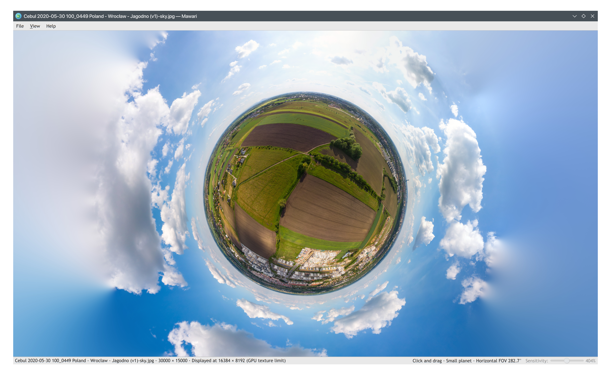
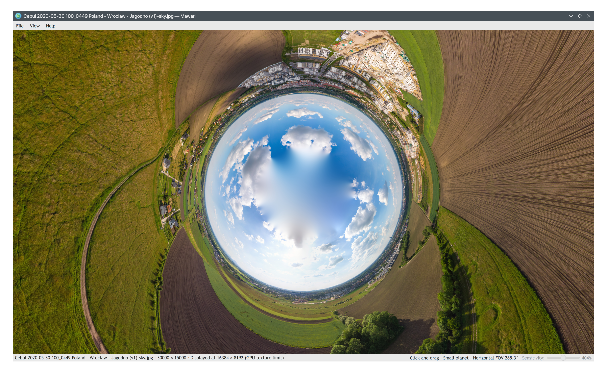
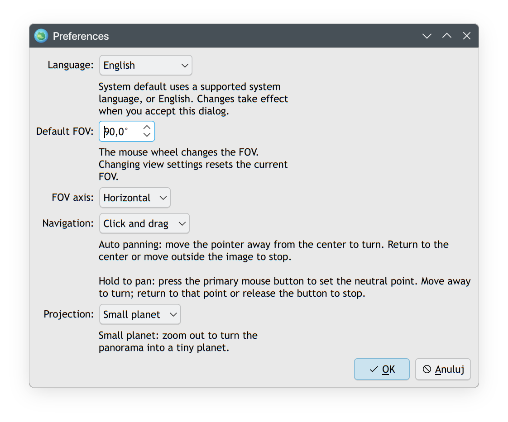

# Mawari

A fast 360° panorama viewer (Qt 6, C++)

A small C++23 and Qt6 viewer for full spherical, equirectangular photographs,
usually stored as 2:1 images. OpenGL renders a perspective view directly from
the panorama using a fragment shader. The interface supports English, Polish, Japanese, Ukrainian and French.

Supports saving viewport as regular images in high resolution.

Written by GPT-6.1-Sol, orchestrated by Michał Gawron (mcvsama).





## Build and run

Requires Make, a C++23 compiler, CMake 3.25+, Qt 6.4+ with Widgets, OpenGL,
OpenGLWidgets, Concurrent, Svg and LinguistTools, and a graphics driver supporting OpenGL 3.3 Core.
The Qt translations package must include the Polish, Japanese, Ukrainian and French
`qtbase_*.qm` catalogs. CMake checks these dependencies; the catalogs are embedded
in the executable, so they are not needed separately at runtime.
Qt Test is required when `BUILD_TESTING` is enabled (the default).

```sh
make
./build/mawari
./build/mawari /path/to/panorama.jpg
```

`make` checks dependencies through CMake before building: compiler support for
C++23, Qt 6.4+ including its development headers and required components, and
the OpenGL development libraries. Missing dependencies stop the build with a
diagnostic from CMake. Installed Qt components also supply Core and Gui.
Qt Test is checked when tests are enabled.

Use `make check-deps` to check and configure without building the application,
`make clean` to remove compiled files, and `make help` for options. Builds are
incremental and reuse an existing build directory's generator, including Ninja.

```sh
make BUILD_TESTING=OFF           # Build only the application; Qt Test is optional.
make JOBS=4                     # Limit parallel compilation.
make BUILD_DIR=build-debug BUILD_TYPE=Debug
make CMAKE_ARGS="-DCMAKE_PREFIX_PATH=/path/to/Qt"
```

CMake can also be used directly:

```sh
cmake -S . -B build -DCMAKE_BUILD_TYPE=Release
cmake --build build --parallel
```

Add `-DBUILD_TESTING=OFF` when configuring directly to omit the tests.

## Install in KDE / Plasma

From the source directory, run:

```sh
make install
```

This builds the program and installs it for the current user, without `sudo`:

- `~/.local/bin/mawari` — executable;
- `~/.local/share/applications/mawari.desktop` — application menu entry;
- `~/.local/share/icons/hicolor/<size>x<size>/apps/mawari.png` — menu icons;
- `~/.local/share/icons/hicolor/scalable/apps/mawari.svg` — vector artwork.

Mawari then appears in the **Graphics** category of the KDE application launcher
and can be found by searching for **Mawari**. The desktop entry stores the full
installed executable path, so launching from the menu does not depend on
`~/.local/bin` being in the desktop session's `PATH`. The installer refreshes
the Plasma 6 menu cache with `kbuildsycoca6` when available in a D-Bus session.
If the entry does not appear immediately, log out and back in.

Install updates by running `make install` again. A different prefix can be
selected with `make install PREFIX=/your/install/directory`; the prefix's
`share` directory must be visible to the desktop through `XDG_DATA_DIRS`.
If `XDG_DATA_HOME` points somewhere other than `~/.local/share`, use
`make install CMAKE_ARGS="-DCMAKE_INSTALL_DATADIR=$XDG_DATA_HOME"` instead.

For a system-wide installation, build as your regular user, then install:

```sh
make
sudo cmake --install build --prefix /usr/local
```

The CMake install command is also available directly for any prefix:

```sh
cmake --install build --prefix /your/install/directory
```

The build renders the SVG artwork to transparent PNGs at 16–512 pixels without
requiring a display server. These sizes are embedded in the executable for the
window and **About Mawari** dialog, so displaying the icon does not depend on an
SVG icon plugin. On Linux, installation also places the desktop entry in
`share/applications` and the SVG and PNG icons under `share/icons/hicolor`.
The installed desktop entry uses the absolute path to the 256-pixel PNG to avoid
icon-theme lookup failures and previously cached misses in the desktop session.

## Controls

- Drop one local image onto the viewer, or use **Open…** (`Ctrl+O`).
- **Click and drag** (`Alt+D`): hold the left mouse button to move the panorama.
  The cursor is hidden while the button is held.
- **Auto panning** (`Alt+A`): move the pointer away from the center to turn continuously.
  Distance from the center controls speed; a small central area stops motion.
  Moving outside the image, pressing Escape, opening a dialog or menu, or
  deactivating the window stops panning. Move the pointer to resume.
- **Hold to pan** (`Alt+H`): press the primary (left) mouse button to set the neutral
  point at that position. Move away from it while holding the button to turn;
  return to that point or release the button to stop. Each press sets a new
  neutral point. The status bar's **Sensitivity** slider adjusts the response
  immediately from 25% to 800%, with a touchpad-friendly default of 400%.
  This setting is saved and only affects Hold to pan; the slider is disabled
  in other modes. Higher values reach useful turning speeds with shorter
  movements, retaining the same dead zone and maximum turning speed.
  Auto panning always uses the image center. After pressing
  Escape, opening a menu or dialog, or losing focus, press the button again to
  resume. The cursor is hidden while holding
  the button and restored when the button is released or navigation is cancelled.
- Scroll up to zoom in and down to zoom out. Small steps allow precise framing;
  Small planet keeps changes in planet size uniform even near maximum zoom-out.
- Right-click for **Navigation**, **Projection**, **Reset to default FOV**, **Open…**,
  **Save image…**, **Preferences…**, and **Quit**, in that order, with a separator before Open.
- **Save image…** (`Ctrl+S`) exports the current framing at a resolution independent
  of the window. The shortcut also works in full screen.
- The File menu also provides Open, Save image, Preferences and Quit.
- **Help → About Mawari** shows the program's author and project orchestration credits.
- **Alt+F** toggles full screen; **View → Full screen** provides the same action.
  Full screen hides the menu and status bars. The UI also follows full-screen
  changes made by the window manager, such as KDE's global shortcut. Alt+F
  remains available while the menu is hidden and also exits externally enabled
  full screen. **Escape** exits full screen and stops panning. Leaving full
  screen restores the menu and status bars.

Navigation modes are also available through **View → Navigation**. Their
shortcuts work in full screen as well. The context menu displays the shortcuts
next to each navigation and projection mode.

Preferences select the interface language, default FOV, its horizontal or vertical axis, the
navigation mode and the projection. Accepting preferences applies them
immediately. Changing view settings resets the current FOV; changing only the
language preserves the current view. The selected axis stays fixed when
resizing the window; the other angle follows the viewport's aspect ratio.
Resetting FOV preserves the manual viewing angles; Small planet's automatic
tilt follows the FOV. Opening another image resets direction and FOV.

The default language choice, **System default**, uses the first supported system
UI language, falling back to English. The explicit choices are **English**,
**Polski**, **日本語**, **Українська** and **Français**. A language change takes effect
after accepting Preferences, without restarting the program. Cancelling leaves
the language unchanged. Menus, status messages, dialogs and loading/export
messages follow this setting. Qt file dialogs are used so their buttons follow
the application language as well. Shortcuts keep the same keys in every language.

Preferences and changes of navigation mode are persisted with `QSettings`.
Window geometry and the last image directory are saved too. On Linux, the
default settings file is `~/.config/Mawari/Mawari.conf`.

## Projections

Choose **View → Projection**, right-click **Projection**, or use Preferences.
The projection choice is saved independently of the mouse navigation mode.
**Alt+1** selects Standard and **Alt+2** selects Small planet, including in full screen.

- **Standard** keeps the perspective view with a FOV range of 10–150 degrees.
- **Small planet** extends the range to 10–350 degrees. At normal zoom levels
  the view matches Standard. Zooming out gradually introduces stereographic
  projection and tilts the view towards the ground, forming a tiny planet.
  Zooming back in reverses the transition. Around 260–320 degrees, the planet
  is visible surrounded by sky; increasing FOV makes it smaller.
  Tilt the view upwards using any navigation mode to pass through the horizon
  and reach **small sky**: a circle of sky surrounded by ground. Looking straight
  up centers the sky circle; looking straight down centers the planet. In Click
  and drag, drag the image downwards to look up; in Auto panning, position the
  pointer above the image center. In Hold to pan, move above the point where
  you pressed the primary button, keeping the button held.

All three navigation modes work with either projection, including manual pitch
and yaw adjustments while looking at the planet. The selected horizontal or
vertical FOV axis remains respected. Both poles are reachable without turning
the view upside down. Switching between projections preserves viewing direction.
Switching back to Standard clamps the
current and default FOV to 150 degrees when necessary. The planet effect assumes
that the photograph's horizon is approximately level.

The effect uses [stereographic projection](https://www.paulbourke.org/panorama/littleplanet/)
for the wide view; zooming past 180 degrees stays finite and continuous.

## Images and rendering

Image formats come from the installed Qt image plugins (including JPEG and
PNG). Decoding, EXIF orientation, and image preparation run in a worker thread.
A loading overlay remains visible in full screen too. It reports file bytes
read and their percentage during decoding, followed by busy indicators for
decoding, image preparation and GPU upload. These are separate stages, rather
than an estimated overall percentage: the codecs and graphics driver do not
provide detailed progress for those operations. File reads are streamed without
an extra in-memory copy of the compressed file; reread byte ranges are counted
only once. For a visible OpenGL view, loading finishes after the new panorama's
first frame is presented. GPU upload and mipmap generation are synchronous and
can briefly pause the indicator's animation.
A newer request supersedes a pending image. A failed decode preserves the
previous panorama. Images exceeding the driver's maximum texture dimensions
are scaled down, with the displayed size reported in the status bar. Qt's default
256 MB decoded-image allocation limit is disabled, so large panoramas such as
30000 × 15000 pixels can be opened when enough memory is available. The compressed
file size does not reflect decoded memory use: that example needs about 1.68 GiB
at 32 bits per pixel, before temporary buffers and GPU textures. Format conversion
reuses the decoded buffer where Qt supports it. The environment variable
`QT_IMAGEIO_MAXALLOC` can explicitly override the allocation limit.

Each image is assumed to cover 360° horizontally and 180° vertically. Images
with a different aspect ratio are accepted with an informational status message;
cropped panoramas and GPano crop metadata are not reconstructed. Longitude wraps
continuously; latitude stops at the poles. Mipmaps and, where available,
anisotropic filtering reduce sampling artifacts. Rendering occurs on demand,
with a timer active during auto panning.

## Saving the current view

**File → Save image…**, the context menu, or `Ctrl+S` opens export options.
The suggested dimensions use the original panorama's angular resolution and
the current projection's local magnification across the frame. The calculation
respects the horizontal/vertical FOV setting. It preserves the captured view's
aspect ratio; changing the width updates the height automatically.

There is no single exact maximum resolution for a reprojected image: scale
varies across the frame, especially with Small planet. To keep very wide views
practical, the automatic suggestion is capped at the original panorama's total
pixel count. A custom width can exceed that suggestion. Enlarging the result
does not create new source detail. The dialog shows an approximate memory
requirement before export.

Export rereads the original file at full resolution and reprojects it on the
CPU in worker threads. It uses the same camera mapping as the OpenGL preview,
including Small planet, Small sky, rotations and FOV. Mipmaps, anisotropic
sampling and additional polar sampling reduce aliasing. The result contains
the image alone. Export is independent of screen resolution and GPU texture
limits; it can use source details lost in a downscaled preview.

Choose lossless **PNG** or **JPEG** at quality 95. A progress dialog reports
source reading, preparation, completed rendering rows and image encoding.
Cancel prevents the output from being committed; decoding may need to finish
before cancellation takes effect. An existing destination is replaced only
after a successful save. The original panorama must remain available, and
cannot be chosen as the destination. Large exports need memory for the full
source, its mipmaps, the result, and codec buffers, in addition to the preview.

## Tests

Logic and event tests run without a desktop:

```sh
ctest --test-dir build -L logic --output-on-failure
```

Run the full suite in a graphical session, or on Linux with Xvfb and Mesa:

```sh
ctest --test-dir build --output-on-failure
xvfb-run -a env LIBGL_ALWAYS_SOFTWARE=1 ctest --test-dir build --output-on-failure
```

Tests cover horizontal and vertical FOV, zoom and pitch limits, preference
persistence and validation, navigation selection, auto panning, drag and drop,
both projections and their zoom limits, failed and superseded loads, and a JPEG exceeding the old 256 MB allocation
limit. Loading tests check byte accounting for JPEG and PNG, the indicator's
lifecycle, full-screen visibility and hidden windows. The rendering test uses a synthetic spherical
direction map to check pixel colors, image orientation, rotation, zoom, the
longitude wrap, and FOV preservation after resizing. It requires a working
OpenGL window; Qt's `offscreen` platform cannot provide that window.
Export tests cover dimension estimation, both FOV axes and projections,
Small sky, the longitude seam, full-resolution source detail, PNG/JPEG output,
cancellation, failure preservation, and the full-screen save shortcut and dialogs.

## Updating translations

Catalogs live in `translations/mawari_{pl,ja,uk,fr}.ts`. English is the source
language. Application strings use `Translations::tr()` so all catalogs share
the `mawari::Translations` context. After editing interface text, run:

```sh
cmake --build build --target update_translations
# Edit the TS catalogs with Qt Linguist, then rebuild.
make
```

The build compiles catalogs with `lrelease` and embeds the resulting QM files.
Localization tests verify catalog completeness and placeholders, system language
selection, persistence, cancellation, and live switching while preserving the view.
